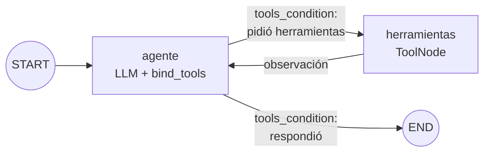

# Agente de razonamiento cíclico con memoria persistente

Pre-entrega 5 de AI Engineering (Coderhouse). Es un agente de soporte interno para **Colibrí**, el e-commerce ficticio de las pre-entregas 3 y 4, hecho con **LangGraph**. Responde consultas sobre clientes, pedidos y envíos:

- **Decide solo** qué herramienta usar y cuándo. No hay rutas `if/else`: el grafo sigue la decisión del modelo con `tools_condition`.
- **Encadena varias herramientas** para llegar a una respuesta: cliente → pedidos → envío.
- **Reintenta** si una herramienta falla y **pide aclaraciones** si la información es ambigua.
- **Recuerda la conversación** por `thread_id` gracias a un checkpointer de SQLite, incluso si se corta el programa y se vuelve a ejecutar.

## El grafo



El ciclo `agente → herramientas → agente` es el patrón **ReAct**. El modelo razona y pide una herramienta, el `ToolNode` la ejecuta y el resultado vuelve al modelo como `ToolMessage`. El modelo decide si necesita otra herramienta o si ya puede responder. El grafo termina solo cuando el modelo responde sin pedir herramientas.

## Estructura

```
data/semilla.sql      # Esquema y datos ficticios (clientes, pedidos, envíos)
config.py             # Rutas, recursion_limit, recorte del historial y creación del LLM
base_datos.py         # SQLite con consultas parametrizadas, ejecutadas en un hilo (asyncio.to_thread)
herramientas.py       # Las 3 herramientas: @tool + esquema Pydantic + docstring para el LLM
grafo.py              # EstadoAgente (hereda de MessagesState), nodos, aristas y prompt
agente.py             # Abre el AsyncSqliteSaver, ejecuta cada pregunta y arma la traza
main.py               # Chat por consola (una pregunta o modo interactivo)
demo.py               # Conversación de prueba que genera la traza en trazas/
modelo_simulado.py    # Reemplazo del LLM para correr sin API key
prueba_sin_api.py     # 25 chequeos sin key
trazas/               # Traza de ejecución (.json y .log)
```

## Cómo levantar el entorno

Requiere Python 3.12.

```bash
git clone https://github.com/devrogerzen/codetest-AI-face5.git
cd codetest-AI-face5
python -m venv .venv
.venv\Scripts\activate          # Windows (source .venv/bin/activate en Linux/Mac)
pip install -r requirements.txt
copy .env.example .env          # cp en Linux/Mac; completá OPENAI_API_KEY
```

La base de datos (`data/colibri.db`) y la memoria del agente (`memoria.sqlite`) se crean solas la primera vez.

## Uso

```bash
# Una pregunta por ejecución: la memoria se mantiene entre ejecuciones con el mismo --thread
python main.py "¿Cuántos pedidos tuvo el cliente 102 y cuál fue el total?" --thread soporte-1
python main.py "¿Y el último?" --thread soporte-1
python main.py --thread soporte-1 --historial      # lo que quedó guardado en ese thread

# Chat interactivo
python main.py --thread soporte-2

# Prueba de ejecución completa, que guarda la traza en trazas/demo.json y trazas/demo.log
python demo.py
```

Todo tiene la opción `--sin-api`, que reemplaza el LLM por `modelo_simulado.py`. Es un modelo de reglas que entiende las preguntas de la demo. Sirve para probar el grafo, las herramientas, el reintento y la memoria sin key; no reemplaza a un modelo real.

```bash
python prueba_sin_api.py
python demo.py --sin-api
python main.py "¿Dónde está el último pedido de Julián Pereyra?" --sin-api
```

### Variables de entorno

| Variable | Requerida | Descripción |
|---|---|---|
| `OPENAI_API_KEY` | **Sí** (con `openai`) | Key de OpenAI |
| `LLM_PROVIDER` | No | `openai` (default) o `anthropic` |
| `OPENAI_MODEL` | No | Default `gpt-4o-mini` |
| `OPENAI_BASE_URL` | No | Para usar otra API compatible con OpenAI |
| `ANTHROPIC_API_KEY` | Si `LLM_PROVIDER=anthropic` | Key de Anthropic |
| `RECURSION_LIMIT` | No | Default `10` |
| `SIMULAR_FALLAS` | No | `1` (default) simula la caída del servicio de envíos; `0` la apaga |

## Herramientas

Cada herramienta tiene un esquema de entrada en **Pydantic**, que rechaza un `cliente_id=0` antes de tocar la base, y un docstring que le explica al modelo **cuándo** usarla. Ante datos inexistentes no lanzan excepciones: devuelven un `error` o un `aviso` que el modelo puede leer para corregirse.

| Herramienta | Entrada | Devuelve | Simula |
|---|---|---|---|
| `buscar_cliente` | `nombre` | id, nombre y ciudad de cada coincidencia (sin distinguir acentos) | Búsqueda en la tabla de clientes |
| `buscar_pedidos` | `cliente_id`, `limite` | cantidad de pedidos, total gastado y pedidos del más nuevo al más viejo | Consulta con `COUNT` / `SUM` sobre pedidos |
| `consultar_envio` | `pedido_id` | empresa, código de seguimiento, estado y fecha estimada | API externa de logística |

**Ciclo de retorno:** el servicio de envíos de Correo Argentino está configurado para fallar en la primera consulta de cada pedido, devolviendo `TEMPORAL: ... no respondió (timeout)`. El prompt le indica al modelo que reintente. Si el pedido todavía no tiene envío, la herramienta devuelve un `aviso`, que es información incompleta. Si el nombre del cliente es ambiguo (hay dos "Lucía Fernández"), el agente pregunta cuál es.

**Seguridad:** el SQL lo escribe el código, siempre con parámetros (`?`). El LLM solo aporta valores ya validados por Pydantic, nunca SQL.

## Estado y persistencia

- **`EstadoAgente(MessagesState)`:** hereda `messages` con el reducer `add_messages`, así que cada nodo **agrega** mensajes al historial en lugar de pisarlo.
- **`AsyncSqliteSaver`:** es la versión asíncrona de `SqliteSaver` (el grafo corre con `astream`). Guarda un checkpoint del estado después de cada nodo en `memoria.sqlite`. El `thread_id` separa las conversaciones: con el mismo id el agente retoma la charla, aunque el programa se haya cerrado; con otro id arranca de cero.
- **`recursion_limit=10`** en cada invocación: es el techo de pasos para que un ciclo que no termina no siga gastando tokens. Si se supera, `GraphRecursionError` se captura y se informa.
- **Historial recortado:** el checkpoint guarda todo, pero al modelo solo le llegan los últimos 30 mensajes (`trim_messages`), empezando siempre por un mensaje del usuario.

## Traza de ejecución

`demo.py` corre esta conversación y guarda la traza en `trazas/`:

| Thread | Pregunta | Qué muestra |
|---|---|---|
| `pedidos-102` | ¿Cuántos pedidos tuvo el cliente 102 y cuál fue el total? | El ejemplo de la consigna |
| `pedidos-102` | ¿Y el último? | Memoria: responde con lo que ya sabe, sin herramientas |
| `pedidos-102` | ¿En qué estado está el envío de ese pedido? | Error `TEMPORAL` → reintento |
| `envio-julian` | ¿Dónde está el último pedido de Julián Pereyra y cuándo llega? | 3 herramientas encadenadas |
| `envio-lucia` | ¿En qué estado está el envío del último pedido de Lucía Fernández? | Nombre ambiguo → pide aclaración |
| `envio-lucia` | La de Mendoza | Retoma la consulta → pedido sin envío (`aviso`) |
| `thread-nuevo` | ¿Y el último? | Otro thread: no tiene contexto |

Fragmento de `trazas/demo_sin_api.log`:

```
[envio-julian] Usuario: "¿Dónde está el último pedido de Julián Pereyra y cuándo llega?"
  → El agente decide usar: buscar_cliente(nombre='Julián Pereyra')
  → buscar_cliente devuelve: {"coincidencias": 1, "clientes": [{"id": 102, "nombre": "Julián Pereyra", "ciudad": "Rosario"}]}
  → El agente decide usar: buscar_pedidos(cliente_id=102)
  → buscar_pedidos devuelve: {"cliente_id": 102, "cliente": "Julián Pereyra", "cantidad_pedidos": 3, "total_gastado": 14500, ...}
  → El agente decide usar: consultar_envio(pedido_id=5012)
  → consultar_envio devuelve: {"pedido_id": 5012, "empresa": "Correo Argentino", "estado": "en_camino", "entrega_estimada": "2026-11-08", ...}
  Respuesta: "El pedido #5012 va por Correo Argentino (seguimiento CA-000417762AR). Estado: en camino. ..."
```

La traza incluida se generó con `python demo.py --sin-api`. Con una key configurada, `python demo.py` genera `trazas/demo.json` y `trazas/demo.log` con el modelo real. El modelo real redacta distinto, pero recorre los mismos pasos.

## Pruebas sin API key

`prueba_sin_api.py` verifica 25 cosas:
- **Herramientas:** la búsqueda sin acentos, los nombres repetidos, los totales sin cancelados, el orden de los pedidos, los errores legibles, la validación de Pydantic, la falla `TEMPORAL` y el aviso de información incompleta.
- **Grafo:** que tenga los nodos `agente` y `herramientas`, las aristas condicionales de `tools_condition` y la arista que cierra el ciclo.
- **ReAct:** que encadene 3 herramientas en una pregunta, que reintente ante el error, que pregunte cuando hay ambigüedad y que retome la consulta con la aclaración.
- **Memoria:** que recuerde con el mismo `thread_id`, que no recuerde con otro, que el historial sobreviva a cerrar y reabrir la conexión con SQLite y que `olvidar()` borre el thread.
- **Límites:** que `recursion_limit` corte un agente que nunca termina, que se genere la traza y que se recorte el historial.
